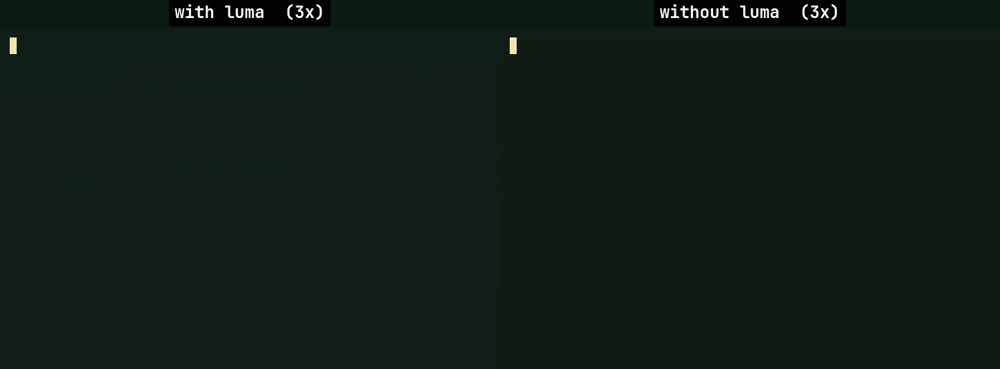

<div align="center">


# Luma

**Smart launcher for you, and your AI agent**

A Linux launcher that finds apps, files — and photos by what's in them. The same
index is open to AI agents: ask one for "the photo of a bear" and it finds it in seconds.

[](https://github.com/sakurartro/luma/actions/workflows/ci.yml)

**For humans**


**For AI agents**


<sub>Same prompt, one run each (Claude Code, Sonnet 5.5, medium effort): 11 s with Luma, 1 min 26 s without.
Both at 3x speed. <a href="#for-ai-agents">More on agents</a>.</sub>

</div>

## Install

```sh
curl -fsSL https://raw.githubusercontent.com/sakurartro/luma/main/install.sh | sh
```

The script downloads the binary into `~/.local/bin` (or a path of your choice: `... | sh -s /usr/local/bin`).
To update later: `luma update` (reinstalls the latest release next to the current binary).

## Setup

<details>
<summary>Keybind and floating window for Hyprland, niri, GNOME, KDE</summary>

Luma does not grab global keys itself — on Wayland that is forbidden by
protocol design. Bind a key to `luma --toggle`: it shows/hides the window
of the running instance; launching the binary again while an instance is live
acts the same. A cold start without the flag opens the window right away.

### Hyprland

**Keybind** — stock in `~/.config/hypr/hyprland.conf`; Omarchy (which does
not read `hyprland.conf`; the entry point is the Lua file) in
`~/.config/hypr/bindings.lua`:

```ini
bind = SUPER, Space, exec, luma --toggle
```

```lua
hl.bind("SUPER + SPACE", hl.dsp.exec_cmd("luma --toggle"))
```

**Floating window** for the app id `luma-rust` (Wayland apps cannot request
floating themselves — the compositor decides) — stock:

```ini
windowrule = float, class:^(luma-rust)$
```

Omarchy in `~/.config/hypr/hyprland.lua`:

```lua
o.window("^(luma-rust)$", { float = true, center = true })
```

Reload afterwards: `hyprctl reload`.

### niri

**Keybind** — in `~/.config/niri/config.kdl`:

```kdl
binds {
    Mod+Space { spawn "luma" "--toggle"; }
}
```

**Floating window** — same file:

```kdl
window-rule {
    match app-id="luma-rust"
    open-floating true
}
```

Restart niri to apply. If `Super+Space` is already taken (e.g. input source
switch), pick another combo — e.g. `SUPER, D` / `Mod+D` — and use it everywhere.

### GNOME / KDE (X11)

**GNOME** — Settings → Keyboard → Custom Shortcuts, command `luma --toggle`.
GNOME has no window rules; the window opens wherever the DE places it (force
floating with an extension, e.g. *Try*).

**KDE** — System Settings → Shortcuts → Add Custom Command `luma --toggle`.
Floating via Window Rules with Window class `luma-rust` (verify with `xprop`
that the class matches on X11).

Transparency on X11 requires a compositor — GNOME and KDE ship one by default.

</details>

## Features

**Search**
- Fuzzy search of applications and files
- Semantic photo search (CLIP) — opt-in; matching files show a `S(N%)` match-strength badge
- Text-in-image search (OCR) — opt-in; matching files show a `T(N%)` badge
- Calculator (`2 + 2`) and currency conversion (`100 usd to eur`)

**Apps**
- Applications from all XDG dirs — system, `~/.local/share`, Flatpak, Snap; a user `.desktop` override shadows the system entry
- Launch ranking from usage stats (with time decay), pinned apps on top (right-click to pin/unpin)
- Category filter pills

**Files and photos**
- Separate views for apps, files, photos and settings (`Alt+1`…`Alt+4`)
- File type icons and cached photo thumbnails in the files grid
- File index with a background watcher and scan progress

**System**
- Power menu — shutdown, reboot, suspend, lock (power button in the bottom bar)
- Settings menu in the launcher (`Alt+4` / `Ctrl+,`) — edits `settings.json` for you
- Full name on hover when a label is truncated

**For AI agents**
- MCP server (`luma mcp`) and CLI (`luma query`) over the same photo and screenshot index — see [below](#for-ai-agents)
- One-click connect for Claude Code, Codex and opencode in Settings → Agents

**Local by default** — the index and the models stay on your machine; see [Privacy](#privacy).

## For AI agents

An agent that is asked to find a photo usually walks the disk with `find` and opens
files one by one. Luma already holds a CLIP and OCR index of your photos, so the agent
asks it instead: one call, under a second, by what is in the picture or by the words
written on it.

**Connect** — Settings → Agents (`Alt+4`) has a button for Claude Code, Codex and
opencode: it registers `luma mcp` with the agent and switches the agent API on. By hand:

```sh
claude mcp add luma --scope user -- luma mcp
codex mcp add luma -- luma mcp
```

and set `"agent_api": true` in `~/.config/luma/settings.json` (no restart needed). The API
is off by default.

The server offers two tools: `luma_search_images` (what the picture shows, English
queries) and `luma_search_text` (words written on it, English text). Each returns the
best matches with a 0–100 score.

**Requirements** — Luma must be running, and `semantic` (for images) and/or `ocr` (for
text) must be on, with indexing done. Only folders in `search_dirs` are searched. With a
search not ready the tool answers with a message saying what to enable.

**Without MCP** — `luma query clip "river in fog"` and `luma query ocr "connection refused"`
print one JSON line. [`agent/skills/luma/SKILL.md`](agent/skills/luma/SKILL.md) is a skill
that teaches an agent to use them.

## Privacy

Nothing leaves your machine except two things you can turn off: the model download
(`semantic` / `ocr`, once) and exchange rates for `100 usd to eur` (`currency`, cached for
an hour). Photos, thumbnails, the index and agent queries stay local.

## Usage

| Key | Action |
|-----|--------|
| `Enter` | Launch the selected (top) result |
| `↑` `↓` `←` `→` | Move the selection (left/right in the grid views) |
| `Alt+1` | Apps |
| `Alt+2` | Files |
| `Alt+3` | Photos |
| `Alt+4` / `Ctrl+,` | Settings |
| `Esc` | Hide the window |
| Right click | Pin / unpin an app |

## Configuration

Edit settings in the launcher (`Alt+4` / `Ctrl+,`) or by hand in
`~/.config/luma/settings.json`. Hand edits, `search_dirs`, `semantic` and `ocr`
apply after a restart (the menu offers a Restart button); everything else
applies at once. New options are appended with their defaults; a broken file
falls back to defaults and is kept.

| Option | Default | |
|--------|---------|--|
| `bg` `surface` `hover` `selected` `border` `accent` `text` `text_dim` | see below | Colors, `#RRGGBB`; an unparsable value renders black |
| `search_dirs` | `~/Documents` `~/Pictures` `~/Desktop` | Folders indexed for file search |
| `hide_patterns` | `["."]` | File name prefixes to hide (dotfiles) |
| `semantic` | `false` | Photo search by meaning (CLIP, English queries). Downloads ~154 MB of models, indexes photos in the background |
| `ocr` | `false` | Image search by the text on them (PaddleOCR, English). Downloads ~12 MB of models, runs after semantic indexing |
| `agent_api` | `false` | Lets agents query Luma (`luma mcp`, `luma query`). Set by Settings → Agents |
| `currency` | `true` | `100 usd to eur` via open.er-api.com, rates cached for an hour. `false` = no network; the calculator still works |

`semantic` and `ocr` cost nothing while off; turning them off keeps the models
and index on disk for later.

Where things live (`$XDG_CONFIG_HOME` / `$XDG_CACHE_HOME` respected):
`~/.config/luma/` — settings, `main.sqlite3`, `models/`;
`~/.cache/luma/thumbs` — photo thumbnails.
Apps are read from `applications/` in `$XDG_DATA_HOME` and every
`$XDG_DATA_DIRS` entry, refreshed when those dirs change.

Full example (the defaults):

```json
{
  "bg": "#0E120B", "surface": "#151B10", "hover": "#1E2716", "selected": "#28331C",
  "border": "#2C3620", "accent": "#A9B665", "text": "#E4E7D0", "text_dim": "#7E8A6C",
  "search_dirs": ["~/Documents", "~/Pictures", "~/Desktop"],
  "hide_patterns": ["."],
  "semantic": false,
  "ocr": false,
  "agent_api": false,
  "currency": true
}
```

### Palettes

<details>
<summary>Cold dark, warm, light</summary>

Cold dark:

```json
{"bg": "#0D1117", "surface": "#161B22", "hover": "#1C2431", "selected": "#24304A", "border": "#2D3748", "accent": "#58A6FF", "text": "#E6EDF3", "text_dim": "#8B949E"}
```

Warm (gruvbox-like):

```json
{"bg": "#282828", "surface": "#32302F", "hover": "#3C3836", "selected": "#504945", "border": "#665C54", "accent": "#D8A657", "text": "#FBF1C7", "text_dim": "#A89984"}
```

Light:

```json
{"bg": "#FBF7EF", "surface": "#F1EBDD", "hover": "#E9E1CE", "selected": "#DFE4CB", "border": "#D3CBB2", "accent": "#5B7A3A", "text": "#2E3324", "text_dim": "#8A8B76"}
```

</details>

## Requirements

- Linux (glibc 2.39+ — Ubuntu 24.04, Fedora 40+, Arch; the ONNX runtime of the semantic search sets this floor)
- The prebuilt binary links at runtime against libfontconfig, libGL (mesa) and libxkbcommon
- Power menu uses systemd: `systemctl poweroff|reboot|suspend`; lock is `loginctl lock-session`, so a locker must listen for it (e.g. hypridle with `lock_cmd`)

## Build from source

```sh
cargo build --release
```

Dev packages (Debian/Ubuntu naming): `libxkbcommon-dev libfontconfig1-dev libgl1-mesa-dev libxcb1-dev`. Binary: `target/release/luma`.

## Troubleshooting

- Reset — delete `~/.config/luma/` (settings and database are recreated; models are downloaded again if enabled)
- Wrong or stale thumbnails — delete `~/.cache/luma/thumbs` (regenerated on demand)
- Stuck hotkey — kill the process or remove `$XDG_RUNTIME_DIR/luma-rust.sock` (or `/tmp/luma-rust-<uid>.sock`)
- Agent does not see Luma — Luma must be running; `claude mcp list` should show `luma`; with `semantic` / `ocr` off the tools return a hint, not results
- Logs go to stderr — run Luma from a terminal to see them

## Uninstall

```sh
rm -f ~/.local/bin/luma ~/.local/bin/luma_rust && rm -rf ~/.config/luma ~/.cache/luma
```

`luma_rust` is the old binary name; installs from before the rename keep it as a link.
If you connected an agent, remove it there too: Settings → Agents, or `claude mcp remove luma`.

## License

[GPL-3.0](LICENSE)
