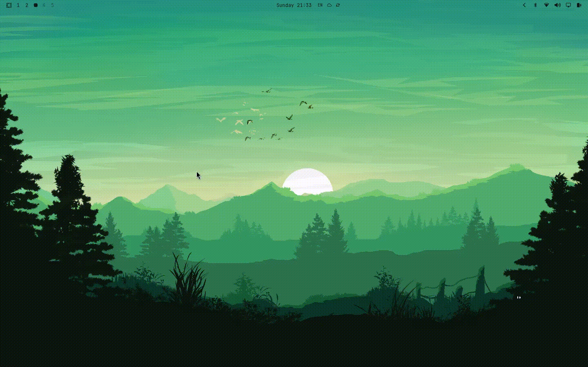

<div align="center">


# Luma

**A Linux launcher that finds apps, files - and photos by what's in them.**

[](https://github.com/sakurartro/luma/actions/workflows/ci.yml)



</div>

## Install

```sh
curl -fsSL https://raw.githubusercontent.com/sakurartro/luma/main/install.sh | sh
```

The script downloads the binary into `~/.local/bin` (or a path of your choice: `... | sh -s /usr/local/bin`).

Luma does not grab global keys itself — on Wayland that is forbidden by
protocol design. The keybind runs `luma_rust --toggle`, which shows/hides
the window of the running instance; launching the binary again while an
instance is live acts the same. A cold start without the flag opens the
window right away.

## Features

- Fuzzy search of applications and files
- Applications from all XDG dirs — system, `~/.local/share`, Flatpak, Snap; a user `.desktop` override shadows the system entry
- Launch ranking from usage stats (with time decay), pinned apps on top (right-click to pin/unpin)
- Category filter pills
- Calculator (`2 + 2`) and currency conversion (`100 usd to eur`)
- File index with a background watcher and scan progress
- Semantic photo search (CLIP) — opt-in; matching files show a `S(N%)` match-strength badge
- Text-in-image search (OCR) — opt-in; matching files show a `T(N%)` badge
- Power menu — shutdown, reboot, suspend, lock (power button in the bottom bar)
- Configurable colors, search dirs and hide patterns via `settings.json`
- `Enter` launches the top result

## Configuration

Settings live at `~/.config/luma/settings.json`. The file is created with
defaults on first run; options added in newer versions are appended to an
existing file with their defaults (your values are kept); a broken file falls
back to defaults (the file is kept).
The app database lives at `~/.config/luma/main.sqlite3` (`$XDG_CONFIG_HOME`
respected). Applications are read from `applications/` under `$XDG_DATA_HOME`
(`~/.local/share`) and every `$XDG_DATA_DIRS` entry (Flatpak/Snap exports
included); the list refreshes in the background when any of these dirs changes.

- `bg`, `surface`, `hover`, `selected`, `border`, `accent`, `text`, `text_dim` — colors, `#RRGGBB` (leading `#` optional). A value that fails to parse renders as black.
- `search_dirs` — list of paths indexed for file search, `~/` allowed
- `hide_patterns` — prefix match on file names; the default `["."]` hides all dotfiles
- `semantic` — semantic photo search by meaning (CLIP embeddings, works best with English queries). `false` by default: the feature then costs nothing — no RAM, no CPU. With `true`, the models (~154 MB) are downloaded from HuggingFace on the next start, photos from `search_dirs` are indexed in the background (progress shown in the launcher), and matching files get a `S(N%)` badge — how strongly the photo matches the query. Toggling it back to `false` stops the feature after a restart; downloaded models and the index stay on disk and are reused if you enable it again.
- `ocr` — search images by the text on them (PaddleOCR, English). `false` by default: the feature then costs nothing — no RAM, no CPU. With `true`, the models (~12 MB) are downloaded from HuggingFace on the next start, images from `search_dirs` are recognized in the background after the semantic indexing (if enabled) finishes, and matching files get a `T(N%)` badge — how well the query matched: 100% for an exact word, less for a partial or fuzzy one, averaged over the query words. Toggling it back to `false` stops the feature after a restart; downloaded models and recognized text stay on disk.
- `currency` — currency conversion as you type, e.g. `100 usd to eur` (3-letter codes) → `100 USD = 92.31 EUR`. `true` by default; rates come from open.er-api.com and are cached in memory for an hour per base currency. With `false`, no network request is ever made; the calculator (`7/2` → `3.5`) keeps working.

Full example (the defaults):

```json
{
  "bg": "#0E120B", "surface": "#151B10", "hover": "#1E2716", "selected": "#28331C",
  "border": "#2C3620", "accent": "#A9B665", "text": "#E4E7D0", "text_dim": "#7E8A6C",
  "search_dirs": ["~/Documents", "~/Pictures", "~/Desktop"],
  "hide_patterns": ["."],
  "semantic": false,
  "ocr": false,
  "currency": true
}
```

### Palettes

Cold dark:

```json
{"bg": "#0D1117", "surface": "#161B22", "hover": "#1C2431", "selected": "#24304A", "border": "#2D3748", "accent": "#58A6FF", "text": "#E6EDF3", "text_dim": "#8B949E"}
```

Warm (gruvbox-like):

```json
{"bg": "#282828", "surface": "#32302F", "hover": "#3C3836", "selected": "#504945", "border": "#665C54", "accent": "#D8A657", "text": "#FBF1C7", "text_dim": "#A89984"}
```

Light:

```json
{"bg": "#FBF7EF", "surface": "#F1EBDD", "hover": "#E9E1CE", "selected": "#DFE4CB", "border": "#D3CBB2", "accent": "#5B7A3A", "text": "#2E3324", "text_dim": "#8A8B76"}
```

## Hyprland

**Keybind** — stock in `~/.config/hypr/hyprland.conf`; Omarchy (which does
not read `hyprland.conf`; the entry point is the Lua file) in
`~/.config/hypr/bindings.lua`:

```ini
bind = SUPER, Space, exec, luma_rust --toggle
```

```lua
hl.bind("SUPER + SPACE", hl.dsp.exec_cmd("luma_rust --toggle"))
```

**Floating window** for the app id `luma-rust` (Wayland apps cannot request
floating themselves — the compositor decides) — stock:

```ini
windowrule = float, class:^(luma-rust)$
```

Omarchy in `~/.config/hypr/hyprland.lua`:

```lua
o.window("^(luma-rust)$", { float = true, center = true })
```

Reload afterwards: `hyprctl reload`.

## niri

**Keybind** — in `~/.config/niri/config.kdl`:

```kdl
binds {
    Mod+Space { spawn "luma_rust" "--toggle"; }
}
```

**Floating window** — same file:

```kdl
window-rule {
    match app-id="luma-rust"
    open-floating true
}
```

Restart niri to apply. If `Super+Space` is already taken (e.g. input source
switch), pick another combo — e.g. `SUPER, D` / `Mod+D` — and use it everywhere.

## GNOME / KDE (X11)

**GNOME** — Settings → Keyboard → Custom Shortcuts, command `luma_rust --toggle`.
GNOME has no window rules; the window opens wherever the DE places it (force
floating with an extension, e.g. *Try*).

**KDE** — System Settings → Shortcuts → Add Custom Command `luma_rust --toggle`.
Floating via Window Rules with Window class `luma-rust` (verify with `xprop`
that the class matches on X11).

Transparency on X11 requires a compositor — GNOME and KDE ship one by default.

## Requirements

- Linux (glibc 2.39+ — Ubuntu 24.04, Fedora 40+, Arch; the ONNX runtime of the semantic search sets this floor)
- The prebuilt binary links at runtime against libfontconfig, libGL (mesa) and libxkbcommon
- Power menu uses systemd: `systemctl poweroff|reboot|suspend`; lock is `loginctl lock-session`, so a locker must listen for it (e.g. hypridle with `lock_cmd`)

## Build from source

```sh
cargo build --release
```

Dev packages (Debian/Ubuntu naming): `libxkbcommon-dev libfontconfig1-dev libgl1-mesa-dev libxcb1-dev`. Binary: `target/release/luma_rust`.

## Troubleshooting

- Reset — delete `~/.config/luma/` (settings and database are recreated)
- Stuck hotkey — kill the process or remove `$XDG_RUNTIME_DIR/luma-rust.sock` (or `/tmp/luma-rust-<uid>.sock`)
- Logs go to stderr — run Luma from a terminal to see them

## Uninstall

```sh
rm ~/.local/bin/luma_rust && rm -rf ~/.config/luma
```
